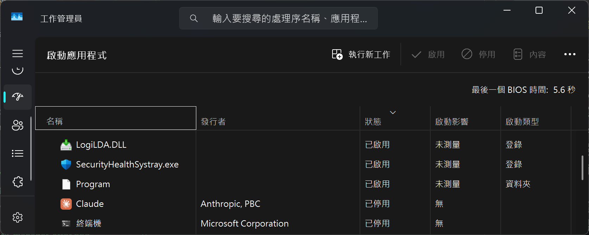
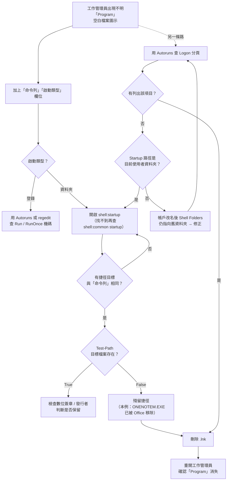
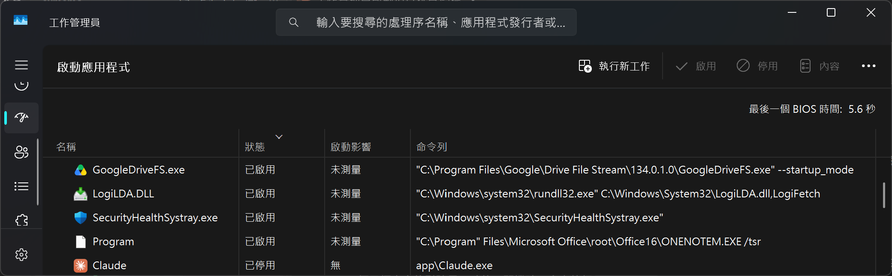
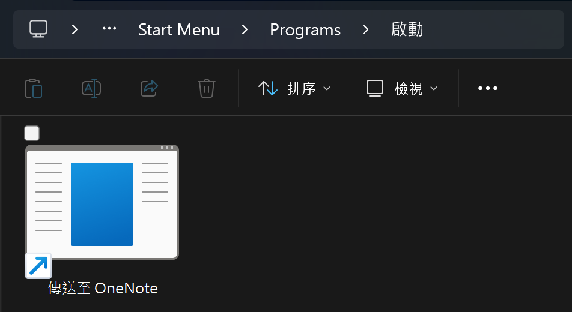
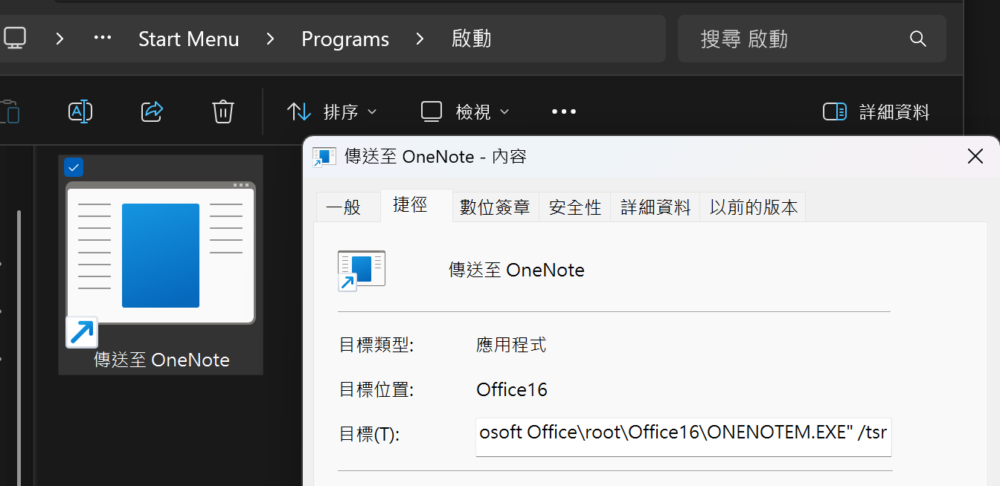

# 工作管理員啟動項目出現不明「Program」排查紀錄



## 問題描述

工作管理員 →「啟動應用程式」中出現名稱為「Program」的項目，沒有發行者，圖示是空白的檔案圖示，狀態為「已啟用」

> [!tip] 「沒有發行者」不是判斷依據
> 截圖中 `LogiLDA.DLL`、`SecurityHealthSystray.exe` 這些正常項目的發行者也是空白，所以發行者空白不代表有問題。「Program」真正異常的地方是**名稱不像程式名稱**，以及**只顯示空白檔案圖示**

## 結論

| 項目   | 說明                                                                                                     |
| ---- | ------------------------------------------------------------------------------------------------------ |
| 來源   | `C:\Users\newuser\AppData\Roaming\Microsoft\Windows\Start Menu\Programs\Startup` 中的「傳送至 OneNote」捷徑         |
| 捷徑目標 | `"C:\Program Files\Microsoft Office\root\Office16\ONENOTEM.EXE" /tsr`                                  |
| 原因   | `ONENOTEM.EXE` 已不存在（已手動解除安裝 Office），捷徑成為殘留項目。工作管理員的「命令列」顯示為 `"C:\Program" Files\...`，表示它在 `Program Files` 的空白處把路徑切開，把 `C:\Program` 當成執行檔，所以名稱顯示為「Program」，也只能顯示空白檔案圖示。同樣位於 `C:\Program Files` 但檔案存在的項目（例如 `GoogleDriveFS.exe`）都顯示正常，可判斷是目標檔案不存在才觸發（依對照推論，未經官方確認） |
| 安全性  | Microsoft Office 留下的捷徑，不是惡意程式。`"C:\Program" Files...` 只是工作管理員的顯示結果，捷徑目標本身的引號正確，不是「未加引號路徑」漏洞，登入時不會去執行 `C:\Program` |
| 影響   | 目標檔案不存在，不論狀態是「已停用」或「已啟用」，登入時都啟動不了任何程式，對系統沒有實質影響；只是在啟動清單留下一筆無效項目，建議刪除                                    |

## 排查流程圖



## 排查過程

### 1. 在工作管理員顯示「命令列」欄位

工作管理員預設只顯示名稱、發行者、狀態，看不出項目實際執行的是什麼，可以加上「命令列」欄位直接查到來源：

1. 按 `Ctrl + Shift + Esc` 開啟工作管理員，切換到「啟動應用程式」
2. 在欄位標題列（例如「名稱」、「發行者」那一列）按右鍵
3. 勾選「命令列」（建議一併勾選「啟動類型」）
4. 找到「Program」那一列，「命令列」欄位會顯示：

   

   ```
   "C:\Program" Files\Microsoft Office\root\Office16\ONENOTEM.EXE /tsr
   ```

   從路徑就能判斷是 Office 的 OneNote 元件；「啟動類型」顯示為「資料夾」（見開頭截圖），表示來源是 Startup 資料夾中的捷徑，而不是登錄機碼

   > [!note] 「Program」名稱的由來
   > 捷徑實際的目標是 `"C:\Program Files\...\ONENOTEM.EXE" /tsr`（見步驟 2），引號包住完整路徑；工作管理員顯示的卻是 `"C:\Program" Files\...`，引號在第一個空白處就結束了
   >
   > 也就是工作管理員把命令列從 `C:\Program Files` 中間的空白切開，將 `C:\Program` 當成執行檔，再取檔名 `Program` 當作顯示名稱。因為 `C:\Program` 不是真正的檔案，讀不到程式圖示，只能顯示空白檔案圖示
   >
   > 同一張截圖中的 `GoogleDriveFS.exe` 也位於 `C:\Program Files` 底下，命令列卻顯示正常（`"C:\Program Files\Google\...\GoogleDriveFS.exe" --startup_mode`），名稱和圖示也正確。兩者的差別在於 `GoogleDriveFS.exe` 存在、`ONENOTEM.EXE` 不存在，所以可以判斷是**目標檔案不存在**時，工作管理員無法解析出完整路徑，才退回用空白分割命令列（依對照推論，未經官方確認）
   >
   > 這只是工作管理員的**顯示**問題。使用者登入時（Startup 資料夾的捷徑在登入後才執行，不是開機時）實際執行的是捷徑本身，捷徑目標的引號是正確的，不會去執行 `C:\Program`

### 2. 檢查 Startup 資料夾



路徑：

```
C:\Users\newuser\AppData\Roaming\Microsoft\Windows\Start Menu\Programs\Startup
```

1. 按 `Win + R`，輸入 `shell:startup` 後按 Enter（或在檔案總管網址列貼上上方路徑）
2. 資料夾中有一個「傳送至 OneNote」捷徑
3. 對捷徑按右鍵 →「內容」→「捷徑」分頁，查看「目標」欄位：

   

   ```
   "C:\Program Files\Microsoft Office\root\Office16\ONENOTEM.EXE" /tsr
   ```

4. 與步驟 1 工作管理員「命令列」欄位的內容比對，路徑與參數相同（只有引號位置不同），確認是同一個項目

### 3. 確認目標檔案是否存在

```powershell
Test-Path 'C:\Program Files\Microsoft Office\root\Office16\ONENOTEM.EXE'
```

結果為 `False`，確認目標檔案已不存在，捷徑是殘留項目

## 處理方式

### 刪除殘留捷徑

直接在 `shell:startup` 資料夾刪除「傳送至 OneNote」捷徑，或執行：

```powershell
Remove-Item "$env:APPDATA\Microsoft\Windows\Start Menu\Programs\Startup\傳送至 OneNote.lnk"
```

重新開啟工作管理員，確認「Program」已消失

> [!warning] 用 Autoruns 刪除的前提
> 也可以在 Autoruns 對「傳送至 OneNote.lnk」按右鍵 → Delete，但必須**先修正 Shell Folders**，否則 Autoruns 掃描的是舊使用者資料夾，清單中不會出現這個捷徑（見下方〈補充：Autoruns 找不到該項目〉）

### 處理舊的使用者資料夾

`C:\Users\{舊使用者名稱}` 已不是登記的使用者設定檔，可以移除，確認與移除步驟見 [[帳戶改名後使用者資料夾路徑不一致#處理舊的使用者資料夾]]

## 補充：Autoruns 找不到該項目

> Autoruns 的下載與操作方式見 [[Autoruns 下載與簡易使用方法]]

一開始先用 Autoruns 查，但「Logon」分頁中沒有這個項目

檢查「Logon」分頁列出的 Startup 資料夾路徑：

```
C:\Users\{使用者名稱}\AppData\Roaming\Microsoft\Windows\Start Menu\Programs\Startup
```

路徑中的使用者名稱必須與目前登入的使用者一致，否則 Autoruns 掃描的是錯誤的使用者資料夾，**無法顯示該使用者對應的啟動程式**

這次不一致的原因是帳戶改名後，登錄 `Shell Folders` 機碼仍指向舊的使用者資料夾，而 Autoruns 讀取的正是這個機碼。確認與修正方式見 [[帳戶改名後使用者資料夾路徑不一致]]

工作管理員不受這個問題影響（它讀到的是正確的 Startup 資料夾），所以排查時優先用工作管理員的「命令列」欄位定位比較快

## 相關筆記

- [[Autoruns 下載與簡易使用方法]]
- [[帳戶改名後使用者資料夾路徑不一致]]
